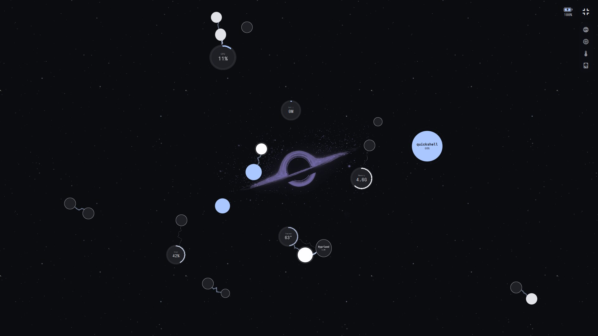
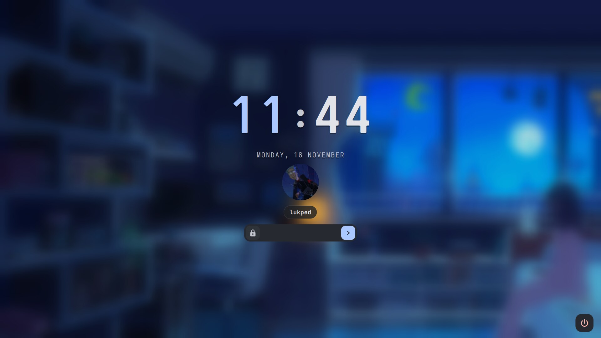
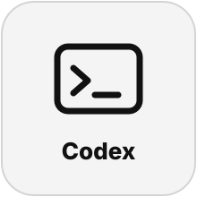
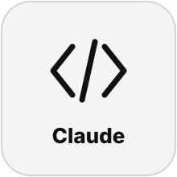

<div align="center">
  
  <h1>Anserin</h1>
  <p>My own desktop shell for Hyprland, built with Quickshell.<br/>It started as a fork of <a href="https://github.com/ilyamiro/serpantinum">Serpantinum</a> and grew from there.</p>
</div>

<br/>

## Previews

<p align="center">
  
  <br/><sub><b>Bubble.</b> Your computer as bubbles floating around a black hole: CPU, memory, heat, disk, network, and the apps that use the most.</sub>
</p>

<p align="center">
  
  <br/><sub><b>The left panel</b> on its User page, a few desktop widgets, and the duck walking around at the bottom.</sub>
</p>

<p align="center">
  
  <br/><sub><b>Control Center</b> from the right edge, open on Terminal: blur, prompt style, window look, Scrollable Tiling and Infinite Desktop.</sub>
</p>

<p align="center">
  
  <br/><sub><b>The Simple lock screen.</b> Just the time, your picture, your name and the password box.</sub>
</p>

<br/>

## What it runs on

**Hyprland only, for now.** You need Hyprland 0.56 or newer, because Anserin hooks into its Lua config.

| Distro | How it goes |
| --- | --- |
| Arch Linux | The installer sets everything up for you. This is what Anserin is made on. |
| Arch-based (EndeavourOS, CachyOS, Manjaro, Garuda…) | Same as Arch. The installer uses `pacman`. |
| Anything else | Not supported yet. If you install the packages yourself (the list is at the top of `install/install.sh`), the installer checks that everything is there and carries on. |

### How heavy is it?

Measured with a system monitor right after a fresh boot, with nothing else open:

- **about 1.8 GB of RAM** for the whole system at idle, with Anserin running
- **about 2.0 GB** with Bubble open

Anserin tries not to hold on to anything it isn't using. Panels, pages and effects load when you open them, and when you close them their timers, background processes and memory are handed back. Bubble, for example, only reads your system while it's on screen. Close it and that work stops.

<br/>

## Install

Run this in a terminal inside Hyprland:

```bash
bash <(curl -fsSL https://raw.githubusercontent.com/lukpednoi/Anserin/main/install/install.sh)
```

It asks before it installs packages and before it touches your Hyprland config. Your config is backed up first (`hyprland.lua.anserin-backup-<date>` next to the original), and only a small, clearly marked block is added to it.

**If that doesn't work**, clone it and run the installer from the clone:

```bash
git clone https://github.com/lukpednoi/Anserin.git ~/.local/share/anserin
bash ~/.local/share/anserin/install/install.sh
```

### Using it

```bash
anserin -start    # open Anserin
anserin -end      # close it (Hyprland and your windows stay open)
anserin -up       # update to the latest version
anserin -ver      # show which version you have
```

After installing, Anserin also starts by itself every time you log in to Hyprland. `anserin -up` keeps your settings and asks before restarting the shell.

### Uninstall

```bash
bash ~/.local/share/anserin/install/uninstall.sh
```

It shows you everything it's about to remove and asks first. It removes the whole shell: the files, the `anserin` command, its settings and cache, and the lines it added to your Hyprland config (anything else you changed in that file stays). The backup made during install is left where it was, just in case. Installed packages are not removed, since other programs may need them.

<br/>

## License and credits

Anserin is free software under the **GNU AGPL v3.0** (see [LICENSE.md](LICENSE.md)), the same license as the project it comes from.

What came from where, what was changed, and what is new is written down in detail on its own page: **[CREDITS.md](CREDITS.md)**.

<sub>Forked from <a href="https://github.com/ilyamiro/serpantinum"><b>ilyamiro/serpantinum</b></a> by <a href="https://github.com/ilyamiro">ilyamiro</a>. Thank you for building it and keeping it open.</sub>

<br/>

<h2 align="center">Made by</h2>

<table align="center">
  <tr>
    <td align="center" width="240">
      <a href="https://github.com/lukpednoi"></a>
      <br/><br/>UI design, interactions and how<br/>everything is meant to work.<br/>Testing and bug hunting.
    </td>
    <td align="center" width="240">
      
      <br/><br/>Code for the<br/><b>Default</b> interface.
    </td>
    <td align="center" width="240">
      
      <br/><br/>Code for the<br/><b>Anserin</b> interface.
    </td>
  </tr>
</table>
