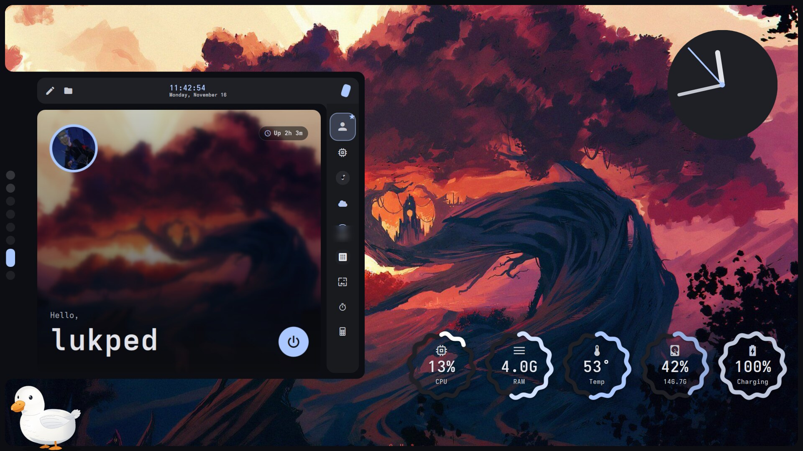
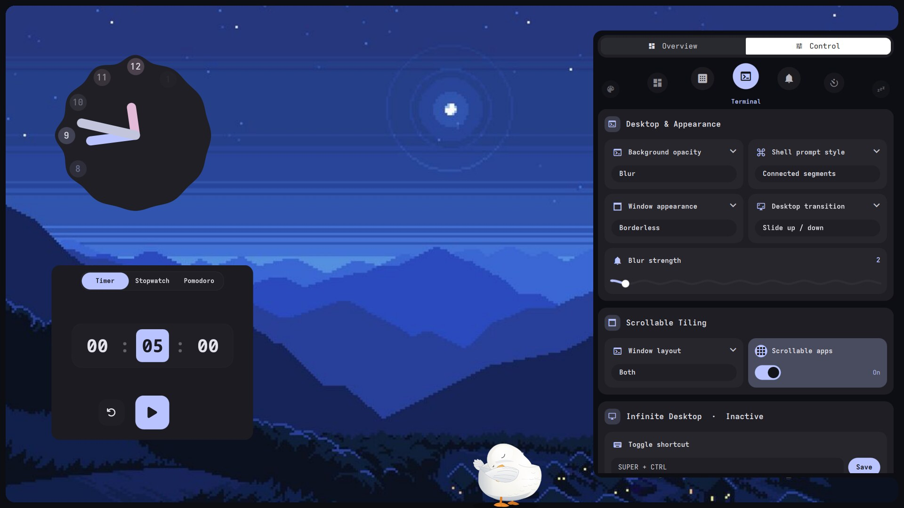

<table>
  <tr>
    <td></td>
    <td></td>
  </tr>
  <tr>
    <td></td>
    <td></td>
  </tr>
</table>

## What it runs on

**Hyprland 0.56 or newer only, for now.**

| Distro | |
| --- | --- |
| Arch Linux | The installer sets up everything. Anserin is made on Arch. |
| Arch-based (EndeavourOS, CachyOS, Manjaro…) | Same as Arch. |
| Anything else | Not supported yet. Install the packages yourself (listed at the top of `install/install.sh`) and the installer will check them and carry on. |

### How heavy is it?

Checked in a system monitor right after boot:

- **~1.8 GB RAM** for the whole system, idle
- **~2.0 GB RAM** with Bubble open

Anserin only runs what's on screen. Close a panel or page and its timers, processes and memory are given back.

## Install

```bash
bash <(curl -fsSL https://raw.githubusercontent.com/lukpednoi/Anserin/main/install/install.sh)
```

It asks before installing packages, and backs up your Hyprland config before adding a few lines to it.

If that doesn't work:

```bash
git clone https://github.com/lukpednoi/Anserin.git ~/.local/share/anserin
bash ~/.local/share/anserin/install/install.sh
```

## Usage

Open Anserin:

```bash
anserin -start
```

Close it. Hyprland and your windows stay open:

```bash
anserin -end
```

Update to the latest version. Your settings are kept:

```bash
anserin -up
```

Show your version:

```bash
anserin -ver
```

Anserin also starts on its own when you log in to Hyprland.

## Wallpapers

Want a starter set of still and video wallpapers? Download them from **[Anserin-Wallpapers](https://github.com/lukpednoi/Anserin-Wallpapers)** and copy what you want into `~/Pictures/Wallpapers`.

## Uninstall

```bash
bash ~/.local/share/anserin/install/uninstall.sh
```

It shows what it will remove and asks first. It removes the whole shell, its settings and the lines it added to your Hyprland config. Your config backup and installed packages stay.

## License and credits

AGPL-3.0, same as Serpantinum. See [LICENSE.md](LICENSE.md).

Where everything comes from, and what was changed: **[CREDITS.md](CREDITS.md)**

<sub>Forked from <a href="https://github.com/ilyamiro/serpantinum"><b>ilyamiro/serpantinum</b></a> by <a href="https://github.com/ilyamiro">ilyamiro</a>. Thank you for building it and keeping it open.</sub>

## Made by

<p>
  <a href="https://github.com/lukpednoi"></a>
  <b>lukpednoi</b><br/>
  Designed the UI and how everything works. Tested it all and hunted down bugs.
</p>
<br clear="left"/>

<p>
  
  <b>Codex</b><br/>
  Wrote the old Default interface (now removed).
</p>
<br clear="left"/>

<p>
  
  <b>Claude</b><br/>
  Wrote the Anserin interface and fixed bugs.
</p>
<br clear="left"/>
